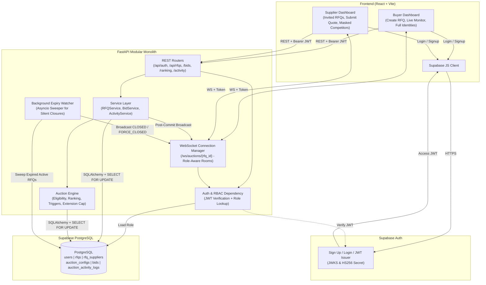
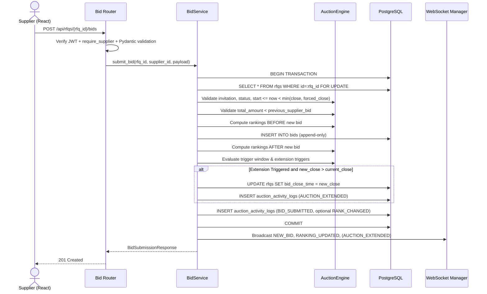
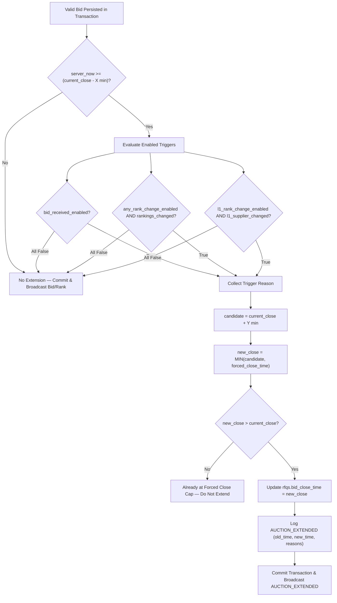

# High-Level Design (HLD) — GoComet British Auction RFQ System

## 1. Project Overview

The **GoComet British Auction RFQ System** is a real-time reverse-auction platform built for freight and logistics procurement. Buyers publish Requests for Quotation (RFQs), invite qualified suppliers, and run transparent, competitive bidding rounds where suppliers iteratively lower their total freight quotes. To prevent last-second "bid sniping," the system enforces configurable **British Auction time-extension rules** bounded by a strict **Forced Bid Close Time**.

---

## 2. Problem Statement

In fixed-deadline RFQs, suppliers often wait until the final seconds before submitting their best rate, denying competitors a fair chance to counter-bid and preventing buyers from discovering the true market price.

This system solves that problem by providing:
- Automatic auction deadline extensions when qualifying bidding activity occurs inside a buyer-defined **Trigger Window ($X$ minutes)**.
- Configurable extension triggers (**Bid Received**, **Any Rank Change**, **L1 Rank Change**).
- A hard **Forced Close Time** ceiling that extensions can never exceed.
- Real-time visibility into rankings, countdown clocks, and full audit history with strict concurrency safety.

---

## 3. Functional Requirements

### Buyer Capabilities
- Create an RFQ with route (`origin`, `destination`), `pickup_date`, `bid_start_time`, `bid_close_time`, `forced_close_time`, and British Auction rules (`X`, `Y`, and trigger flags).
- Invite multiple suppliers to an RFQ.
- Monitor all auctions with live lowest bid, current close time, forced close time, and status (`UPCOMING`, `ACTIVE`, `CLOSED`, `FORCE_CLOSED`).
- View full supplier identities, real-time rankings (`L1`, `L2`, `L3`, ...), full quotation breakdowns (carrier, freight, origin, destination, transit time, validity), complete bid history, and audit activity logs with extension reasons.

### Supplier Capabilities
- View invited RFQs and live auction progress.
- Inspect current lowest bid and anonymized competitor rankings (identities masked to preserve blind auction fairness).
- Submit structured quotations whose `total_amount` is strictly lower than the supplier's own previous accepted bid.
- View personal bid history and receive real-time ranking, extension, and closure updates via WebSockets.

### Auction Engine Rules
1. `bid_start_time < initial_bid_close_time < forced_close_time`.
2. `trigger_window_minutes > 0` and `extension_duration_minutes > 0`.
3. Bids are accepted strictly when `bid_start_time <= server_now < min(bid_close_time, forced_close_time)`. Exact equality at close time is rejected.
4. All charge components must be non-negative; `total_amount = freight_charges + origin_charges + destination_charges`.
5. Rankings are computed from each supplier's **latest** accepted bid, sorted by `(total_amount ASC, created_at ASC, id ASC)`.
6. When a qualifying trigger fires inside `[current_close_time - X, current_close_time)`:
   $$\text{NewCloseTime} = \min(\text{CurrentCloseTime} + Y,\ \text{ForcedCloseTime})$$
7. Every bid, rank change, extension (with old/new close times and trigger reason), and closure is persisted in `auction_activity_logs` inside the same database transaction.

---

## 4. Technology Stack

| Layer | Technology | Rationale |
|---|---|---|
| Frontend | React + Vite + React Router | Fast SPA workflow, modular dashboards, clean protected routing. |
| Backend | Python + FastAPI | Async support, native WebSockets, dependency injection, automatic OpenAPI docs. |
| Validation | Pydantic v2 | Strict schema validation for monetary decimals and UTC timestamps. |
| Database | PostgreSQL (Supabase) | ACID transactions, row-level locking (`SELECT ... FOR UPDATE`), exact `NUMERIC` arithmetic, `JSONB` audit payloads. |
| ORM & Migrations | SQLAlchemy 2.0 + Alembic | Explicit transaction control, declarative relational models, reproducible schema migrations. |
| Authentication | Supabase Auth | Managed identity, password hashing, and JWT issuance without duplicating auth logic. |
| Real-Time | FastAPI WebSockets | Instant push updates for bids, rank shifts, extensions, and closures. |
| Testing | Pytest | Deterministic unit, integration, and concurrent-bid verification. |

---

## 5. High-Level Architecture Diagram



---

## 6. Component Responsibilities

1. **API / Router Layer (`app/routers/`)**: Parses HTTP requests, runs authentication/RBAC dependencies, validates input with Pydantic, invokes service methods, and returns typed responses. Contains zero auction business logic.
2. **Schema Layer (`app/schemas/`)**: Defines strict request/response DTOs, timestamp timezone enforcement, and numeric validations.
3. **Service Layer (`app/services/`)**: Coordinates database transactions across models (`RFQService`, `BidService`, `ActivityService`) and triggers post-commit WebSocket broadcasts.
4. **Auction Engine (`app/services/auction_engine.py`)**: Pure and deterministic domain logic for bid eligibility, supplier ranking (`L1`, `L2`, `L3`), trigger-window checks, trigger evaluation (`BID_RECEIVED`, `ANY_RANK_CHANGE`, `L1_RANK_CHANGE`), capped close-time extension, and forced-closure checks.
5. **Database Layer (`app/models/`, `app/database.py`)**: SQLAlchemy models, foreign keys, unique constraints, indexes, and transaction session management.
6. **WebSocket Layer (`app/websocket/manager.py`)**: Tracks active connections per `rfq_id` along with verified `(user_id, role)` metadata. Serializes role-filtered payloads so buyers receive supplier identities while suppliers receive anonymized labels.
7. **Expiry Watcher (`app/services/expiry_watcher.py`)**: Lightweight periodic asyncio task that transitions expired `ACTIVE` auctions into `CLOSED` or `FORCE_CLOSED`, writes closure audit logs, and broadcasts closure events to connected clients.

---

## 7. Authentication Architecture

- **Identity Provider (Supabase Auth):** Handles signup, login, password resets, and signed JWT access tokens containing `sub` (UUID), `email`, and `exp`.
- **FastAPI Verification (`app/dependencies/auth.py`):**
  1. Extracts `Bearer <token>` from HTTP `Authorization` header (or `?token=` query parameter for WebSocket upgrade).
  2. Verifies JWT signature using Supabase JWKS (`/.well-known/jwks.json`) or `SUPABASE_JWT_SECRET`, validating `aud="authenticated"` and `exp`.
  3. Queries `public.users` by `id = UUID(sub)` to resolve the authoritative role (`BUYER` or `SUPPLIER`).
- **Never Trust Client Roles:** Role checks (`require_buyer`, `require_supplier`) always rely on the backend database record.
- **Resource Authorization:**
  - Buyers can only manage RFQs where `rfq.buyer_id == current_user.id`.
  - Suppliers can only access or bid on RFQs where `(rfq_id, current_user.id)` exists in `rfq_suppliers`.

---

## 8. Bid Submission Workflow



---

## 9. Auction Extension Workflow



### Edge-Case Rules
- **First Bid in Trigger Window:** Transitions `L1` from `None` to `Supplier A`, satisfying both `ANY_RANK_CHANGE` and `L1_RANK_CHANGE`.
- **New Entrant at L2:** Changes the ranking table (triggers `ANY_RANK_CHANGE`) without changing `L1` (does not trigger `L1_RANK_CHANGE`).
- **Tie-Breaking:** Equal `total_amount` bids are ordered by `(total_amount ASC, created_at ASC, id ASC)` so the earlier bidder retains the higher rank.
- **Boundary Rejection:** A bid arriving at `server_now == bid_close_time` or `server_now == forced_close_time` is rejected.

---

## 10. WebSocket Communication

- **Endpoint:** `WS /ws/auctions/{rfq_id}?token=<jwt>`
- **Lifecycle:**
  1. Client fetches initial state via REST (`GET /api/rfqs/{rfq_id}/auction`, `/ranking`, `/activity`).
  2. Client opens WebSocket connection; server validates token and confirms buyer ownership or supplier invitation.
  3. Server broadcasts JSON envelopes after database commit:
     - `NEW_BID`
     - `RANKING_UPDATED`
     - `AUCTION_EXTENDED`
     - `AUCTION_CLOSED`
     - `AUCTION_FORCE_CLOSED`
- **Role-Aware Payloads:** `ConnectionManager` formats outgoing payloads per connection role — Buyers see real supplier names/emails, while Suppliers see deterministic masked labels (`Supplier A`, `Supplier B`, and `You` for their own bids).

---

## 11. Concurrency Handling

Two suppliers bidding on the same RFQ within milliseconds could otherwise read stale rankings or overwrite each other's `bid_close_time` extension.

**Mechanism:**
1. Every bid submission executes inside a single SQLAlchemy transaction.
2. The first statement acquires a PostgreSQL row-level exclusive lock:
   ```sql
   SELECT * FROM rfqs WHERE id = :rfq_id FOR UPDATE;
   ```
3. Concurrent bids on **the same RFQ** block until the active transaction commits, then observe the freshly committed bids and updated `bid_close_time`.
4. Bids on **different RFQs** lock different rows and execute completely in parallel with zero cross-RFQ contention.
5. All WebSocket broadcasts happen strictly **after** `session.commit()`, guaranteeing no client ever sees uncommitted or rolled-back bids.

---

## 12. Scalability Considerations

For this assignment, a single-instance FastAPI server with an in-memory WebSocket `ConnectionManager` and an asyncio expiry watcher is simple, fast, and dependency-free.

To scale horizontally across multiple backend replicas in production:
- **Multi-Instance WebSockets:** Introduce **Redis Pub/Sub** (or PostgreSQL `LISTEN/NOTIFY`). Each FastAPI instance publishes post-commit auction events to channel `auction:{rfq_id}`, and all instances forward events to their locally connected sockets.
- **Distributed Expiry Closure:** Replace the in-process asyncio watcher with a single leader-elected worker or `SELECT ... FOR UPDATE SKIP LOCKED` batch job so multiple instances never emit duplicate closure events.
- **Read Scaling:** Route read-heavy listing/analytics queries to PostgreSQL read replicas while keeping all bid writes and `SELECT FOR UPDATE` locks on the primary node.

---

## 13. Key Architectural Decisions & Trade-Offs

| Decision | Benefit | Trade-Off |
|---|---|---|
| **Modular Monolith over Microservices** | Single ACID transaction spans bid insert, ranking, extension, and audit log; simple deployment and debugging. | Tighter deployment coupling if teams grow very large (mitigated by clean internal module boundaries). |
| **Append-Only `bids` Table** | Full historical negotiation trail; zero risk of losing audit data. | Ranking queries must select each supplier's latest bid (mitigated by composite index `(rfq_id, supplier_id, created_at DESC)`). |
| **REST for Writes + WS for Push** | Deterministic HTTP status codes, clean validation errors, easy idempotency and testing. | Slightly more client code than pure-WS RPC, but far cleaner failure semantics. |
| **Dual Closure Enforcement (Lazy Check + Background Sweeper)** | Bids can **never** sneak in after close/forced-close even if the sweeper is delayed; UI still receives live closure notifications when no bids arrive. | Slight complexity of keeping closure status derivation centralized in `AuctionEngine`. |
| **Server UTC Timestamps Only** | Eliminates client timezone bugs and local clock tampering. | Frontend must sync countdown timers using server-returned UTC time. |
