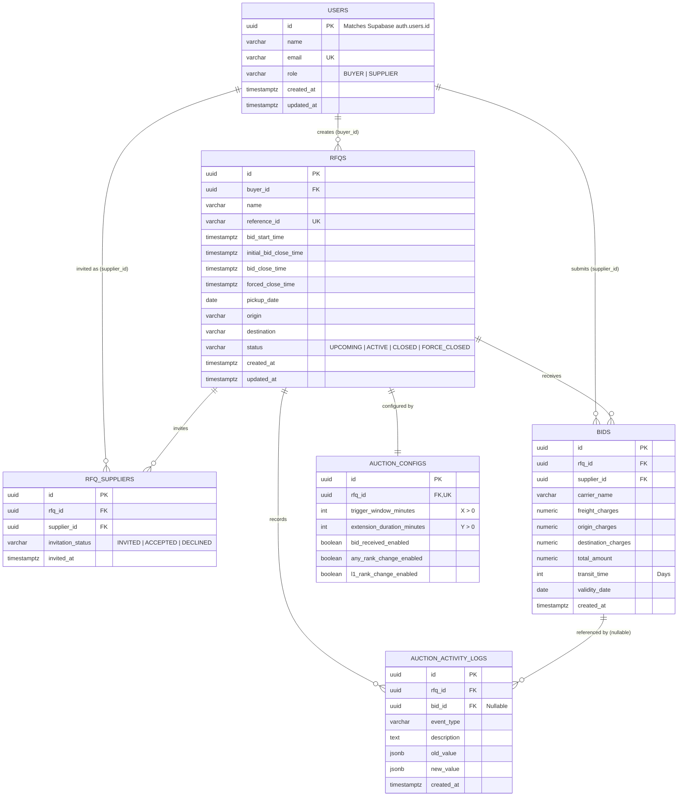

# Database Schema Design — GoComet British Auction RFQ System

## 1. Overview

The database runs on **Supabase PostgreSQL** and is accessed by FastAPI through **SQLAlchemy 2.0** and **Alembic** migrations. Every table uses timezone-aware UTC timestamps (`TIMESTAMPTZ`) and `UUID` primary keys. Monetary amounts use exact fixed-point `NUMERIC(12, 2)` to avoid IEEE-754 floating-point rounding drift.

---

## 2. Entity-Relationship (ER) Diagram

---

## 3. Table Definitions

### 3.1 `users`
Stores application-specific profiles and authoritative RBAC roles, keyed by the Supabase Auth user UUID (`auth.users.id`).

| Column | Type | Constraints | Description |
|---|---|---|---|
| `id` | `UUID` | `PRIMARY KEY` | Linked directly to Supabase Auth `sub` UUID. |
| `name` | `VARCHAR(150)` | `NOT NULL` | Display name or company name. |
| `email` | `VARCHAR(255)` | `NOT NULL, UNIQUE` | User email address. |
| `role` | `VARCHAR(20)` | `NOT NULL, CHECK (role IN ('BUYER', 'SUPPLIER'))` | Authoritative role enforced by FastAPI RBAC. |
| `created_at` | `TIMESTAMPTZ` | `NOT NULL, DEFAULT now()` | Profile creation timestamp (UTC). |
| `updated_at` | `TIMESTAMPTZ` | `NOT NULL, DEFAULT now()` | Last modification timestamp (UTC). |

---

### 3.2 `rfqs`
Stores RFQ shipment details, auction timing windows, and lifecycle state.

| Column | Type | Constraints | Description |
|---|---|---|---|
| `id` | `UUID` | `PRIMARY KEY, DEFAULT gen_random_uuid()` | Unique RFQ identifier. |
| `buyer_id` | `UUID` | `NOT NULL, FK -> users(id) ON DELETE RESTRICT` | Buyer who owns the RFQ. |
| `name` | `VARCHAR(200)` | `NOT NULL` | Descriptive RFQ title. |
| `reference_id` | `VARCHAR(64)` | `NOT NULL, UNIQUE` | Human-readable RFQ reference code (e.g., `RFQ-2026-101`). |
| `bid_start_time` | `TIMESTAMPTZ` | `NOT NULL` | UTC timestamp when bidding opens. |
| `initial_bid_close_time` | `TIMESTAMPTZ` | `NOT NULL` | Original scheduled close time before any extensions. |
| `bid_close_time` | `TIMESTAMPTZ` | `NOT NULL` | Current effective close time (mutated on extensions). |
| `forced_close_time` | `TIMESTAMPTZ` | `NOT NULL` | Hard upper limit that `bid_close_time` can never exceed. |
| `pickup_date` | `DATE` | `NOT NULL` | Planned cargo pickup / service date. |
| `origin` | `VARCHAR(150)` | `NOT NULL` | Origin port or city. |
| `destination` | `VARCHAR(150)` | `NOT NULL` | Destination port or city. |
| `status` | `VARCHAR(20)` | `NOT NULL, CHECK (status IN ('UPCOMING','ACTIVE','CLOSED','FORCE_CLOSED'))` | Current lifecycle status. |
| `created_at` | `TIMESTAMPTZ` | `NOT NULL, DEFAULT now()` | Creation timestamp (UTC). |
| `updated_at` | `TIMESTAMPTZ` | `NOT NULL, DEFAULT now()` | Last update timestamp (UTC). |

**Table Constraints:**
- `ck_rfqs_start_before_initial_close`: `bid_start_time < initial_bid_close_time`
- `ck_rfqs_initial_before_forced_close`: `initial_bid_close_time < forced_close_time`
- `ck_rfqs_close_lte_forced_close`: `bid_close_time <= forced_close_time`

---

### 3.3 `rfq_suppliers`
Junction table connecting invited suppliers to an RFQ.

| Column | Type | Constraints | Description |
|---|---|---|---|
| `id` | `UUID` | `PRIMARY KEY, DEFAULT gen_random_uuid()` | Invitation record ID. |
| `rfq_id` | `UUID` | `NOT NULL, FK -> rfqs(id) ON DELETE CASCADE` | Target RFQ. |
| `supplier_id` | `UUID` | `NOT NULL, FK -> users(id) ON DELETE RESTRICT` | Invited supplier user ID. |
| `invitation_status` | `VARCHAR(20)` | `NOT NULL, DEFAULT 'INVITED', CHECK (...)` | `INVITED`, `ACCEPTED`, or `DECLINED`. |
| `invited_at` | `TIMESTAMPTZ` | `NOT NULL, DEFAULT now()` | UTC invitation timestamp. |

**Table Constraints:**
- `uq_rfq_suppliers_rfq_supplier`: `UNIQUE (rfq_id, supplier_id)` — prevents duplicate invitations.

---

### 3.4 `auction_configs`
Stores the British Auction anti-sniping parameters (strict 1:1 relationship with `rfqs`).

| Column | Type | Constraints | Description |
|---|---|---|---|
| `id` | `UUID` | `PRIMARY KEY, DEFAULT gen_random_uuid()` | Config ID. |
| `rfq_id` | `UUID` | `NOT NULL, UNIQUE, FK -> rfqs(id) ON DELETE CASCADE` | Unique FK enforcing 1:1 with `rfqs`. |
| `trigger_window_minutes` | `INTEGER` | `NOT NULL, CHECK (trigger_window_minutes > 0)` | Window $X$ before close time monitored for triggers. |
| `extension_duration_minutes` | `INTEGER` | `NOT NULL, CHECK (extension_duration_minutes > 0)` | Extension increment $Y$ added when triggered. |
| `bid_received_enabled` | `BOOLEAN` | `NOT NULL, DEFAULT TRUE` | Trigger A: any valid bid in last $X$ min. |
| `any_rank_change_enabled` | `BOOLEAN` | `NOT NULL, DEFAULT FALSE` | Trigger B: any supplier rank change in last $X$ min. |
| `l1_rank_change_enabled` | `BOOLEAN` | `NOT NULL, DEFAULT FALSE` | Trigger C: lowest bidder (L1) identity changes in last $X$ min. |

---

### 3.5 `bids`
Immutable, append-only ledger of all accepted supplier quotations.

| Column | Type | Constraints | Description |
|---|---|---|---|
| `id` | `UUID` | `PRIMARY KEY, DEFAULT gen_random_uuid()` | Unique bid ID. |
| `rfq_id` | `UUID` | `NOT NULL, FK -> rfqs(id) ON DELETE CASCADE` | RFQ being quoted. |
| `supplier_id` | `UUID` | `NOT NULL, FK -> users(id) ON DELETE RESTRICT` | Submitting supplier. |
| `carrier_name` | `VARCHAR(150)` | `NOT NULL` | Proposed shipping line / carrier name. |
| `freight_charges` | `NUMERIC(12, 2)` | `NOT NULL, CHECK (freight_charges >= 0)` | Base freight cost. |
| `origin_charges` | `NUMERIC(12, 2)` | `NOT NULL, CHECK (origin_charges >= 0)` | Origin handling/port charges. |
| `destination_charges` | `NUMERIC(12, 2)` | `NOT NULL, CHECK (destination_charges >= 0)` | Destination handling/port charges. |
| `total_amount` | `NUMERIC(12, 2)` | `NOT NULL, CHECK (total_amount >= 0)` | Exact sum: `freight + origin + destination`. |
| `transit_time` | `INTEGER` | `NOT NULL, CHECK (transit_time > 0)` | Estimated transit duration in days. |
| `validity_date` | `DATE` | `NOT NULL` | Quote expiration date. |
| `created_at` | `TIMESTAMPTZ` | `NOT NULL, DEFAULT now()` | Authoritative server-side submission time (UTC). |

---

### 3.6 `auction_activity_logs`
Immutable audit trail capturing every auction state transition and extension justification.

| Column | Type | Constraints | Description |
|---|---|---|---|
| `id` | `UUID` | `PRIMARY KEY, DEFAULT gen_random_uuid()` | Log entry ID. |
| `rfq_id` | `UUID` | `NOT NULL, FK -> rfqs(id) ON DELETE CASCADE` | Associated RFQ. |
| `bid_id` | `UUID` | `NULLABLE, FK -> bids(id) ON DELETE SET NULL` | Related bid (null for pure clock closures). |
| `event_type` | `VARCHAR(40)` | `NOT NULL` | `BID_SUBMITTED`, `RANK_CHANGED`, `AUCTION_EXTENDED`, `AUCTION_CLOSED`, `AUCTION_FORCE_CLOSED`. |
| `description` | `TEXT` | `NOT NULL` | Human-readable summary (including trigger reason). |
| `old_value` | `JSONB` | `NULLABLE` | Previous state snapshot (e.g., old rank / old close time). |
| `new_value` | `JSONB` | `NULLABLE` | New state snapshot (e.g., new rank / new close time / trigger). |
| `created_at` | `TIMESTAMPTZ` | `NOT NULL, DEFAULT now()` | Event timestamp (UTC). |

---

## 4. Index Strategy

| Table | Index | Columns | Purpose |
|---|---|---|---|
| `users` | `ix_users_role` | `(role)` | Fast lookup of available suppliers for invitation lists. |
| `rfqs` | `ix_rfqs_buyer_status` | `(buyer_id, status)` | Buyer dashboard listing and status filtering. |
| `rfqs` | `ix_rfqs_status_close_time` | `(status, bid_close_time)` | Fast expiry watcher queries for active auctions past close time. |
| `rfq_suppliers` | `uq_rfq_suppliers_rfq_supplier` | `(rfq_id, supplier_id)` | Unique constraint + O(log N) invitation authorization check. |
| `rfq_suppliers` | `ix_rfq_suppliers_supplier` | `(supplier_id)` | Supplier dashboard "My Invited RFQs" lookup. |
| `bids` | `ix_bids_rfq_supplier_created` | `(rfq_id, supplier_id, created_at DESC)` | Fast lookup of each supplier's latest bid for ranking and lower-bid validation. |
| `bids` | `ix_bids_rfq_created` | `(rfq_id, created_at DESC)` | Chronological bid history per RFQ. |
| `auction_activity_logs` | `ix_activity_rfq_created` | `(rfq_id, created_at DESC)` | Ordered auction activity timeline. |

---

## 5. Historical Bid Storage Strategy

- **Never Overwrite Previous Bids:** Every accepted quotation inserts a brand-new row in `bids`.
- **Why:** Procurement requires a verifiable audit trail showing how each supplier reduced their quote across bidding rounds, enabling buyer analytics (price compression %) and dispute resolution.
- **Computing Current Rankings:** For a given `rfq_id`, the Auction Engine selects each supplier's most recent bid (ordered by `created_at DESC, id DESC`), then sorts those latest bids by `(total_amount ASC, created_at ASC, id ASC)` to assign `L1`, `L2`, `L3`, ...

---

## 6. Database Transaction & Concurrency Considerations

- **Atomic Bid Unit of Work:** The following steps run inside a single PostgreSQL transaction:
  1. `SELECT * FROM rfqs WHERE id = :rfq_id FOR UPDATE` (acquires row-level lock on the RFQ).
  2. Validate invitation, server UTC clock against `bid_start_time`, `bid_close_time`, and `forced_close_time`.
  3. Fetch supplier's latest bid and verify `new_total < previous_total`.
  4. Snapshot rankings before insert.
  5. Insert new `bids` row.
  6. Recompute rankings after insert.
  7. Evaluate extension triggers inside `[bid_close_time - X, bid_close_time)` and update `rfqs.bid_close_time = MIN(bid_close_time + Y, forced_close_time)` if extended.
  8. Insert corresponding `auction_activity_logs` rows (`BID_SUBMITTED`, `RANK_CHANGED`, `AUCTION_EXTENDED`).
  9. `COMMIT`.
- **Serialization Scope:** Locking the `rfqs` row serializes concurrent bids targeting the **same** RFQ while keeping all other RFQs completely concurrent.
- **No Uncommitted Reads / Broadcasts:** WebSocket broadcasts fire strictly after `COMMIT` succeeds. If any validation or DB error occurs, the transaction rolls back atomically.
